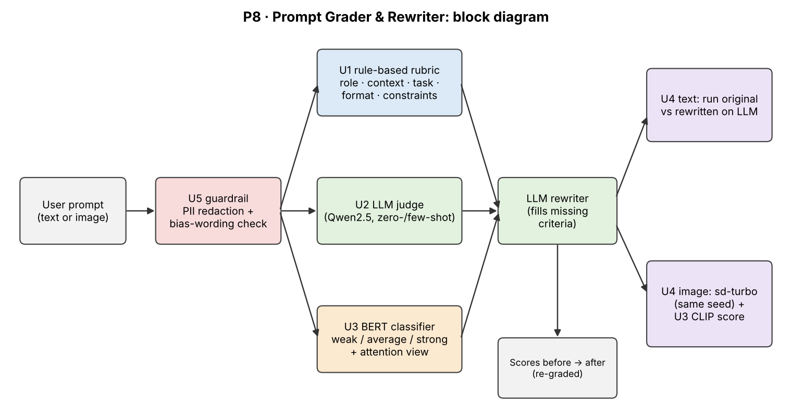

# P8 · Prompt Grader & Rewriter

**Generative AI CA mini-project · Ayush Pisal · Roll No. 08 · MIT ADT University (B.Tech CSE AI & Analytics)**

The app scores a student's prompt on a five-part rubric (**role, context, task, format, constraints**), rewrites it, and shows the output of the original and the rewritten prompt side by side, for both **text** and **image** prompts.

- 🔗 **Live app:** `https://huggingface.co/spaces/<your-hf-username>/p8-prompt-grader`
- 🔗 **Fine-tuned BERT:** `https://huggingface.co/<your-hf-username>/p8-bert-prompt-quality`



## What each unit adds

| Unit | Requirement in P8 | Where in the code |
|---|---|---|
| **U1** Foundations | Rubric (role, context, task, format, constraints), with a transparent rule-based scorer; zero-shot vs few-shot judge compared; BERT class probabilities as the probability view; lifecycle diagram | `p8/rubric.py`, `docs/lifecycle.png` |
| **U2** LLMs | LLM judge (Qwen2.5-1.5B-Instruct) that grades with **few-shot graded examples**; prompt-based learning compared with BERT fine-tuning; BERT attention explanation | `p8/judge.py`, `p8/llm.py` |
| **U3** GPT · BERT · multimodal | **BERT classifier** fine-tuned to predict weak/average/strong; **CLIP score** for image prompts | `train_bert.py`, `p8/classifier.py`, `p8/clip_score.py` |
| **U4** Tools & generation | Runs the original and rewritten prompts: text on the LLM, images on **sd-turbo** with the same seed (PyTorch) | `p8/pipeline.py`, `p8/imagegen.py` |
| **U5** Responsible AI | Rubric checks for **biased wording** and **personal data**, with PII redacted before any model sees the prompt; measured detector precision/recall; counterfactual bias test of the graders | `p8/safety.py`, `evaluate.py` |

## Run it

```bash
pip install -r requirements.txt gradio==6.32.0
python app.py                       # http://localhost:7860
LLM_BACKEND=mock pytest -q tests    # fast tests, no model downloads
```

### Train BERT and produce the results (Google Colab, free T4 GPU)
Open `notebooks/P8_train_and_evaluate.ipynb` in Colab and choose **Runtime → Run all**. It:
1. fine-tunes `bert-base-uncased` on 3,000 synthetic rubric-labelled prompts (`python train_bert.py`, about 3 min)
2. runs `python evaluate.py`, which writes every table to `results/` (`summary.md` is ready to paste into the report)
3. pushes the model to the Hugging Face Hub so the Space can load it

## Deploy on Hugging Face Spaces (free CPU)
1. Create a Space: SDK **Gradio**, hardware **CPU basic (free)**.
2. Upload every file in this repo except `models/` (or `git push` to the Space).
3. Under **Settings → Variables and secrets**, add the variable `BERT_MODEL = <your-hf-username>/p8-bert-prompt-quality`.
4. Optional variables:
   - `LLM_MODEL=Qwen/Qwen2.5-0.5B-Instruct` for faster but weaker answers
   - `RUN_MAX_TOKENS=150` for shorter outputs
   - `LLM_BACKEND=hf_api` plus a **secret** `HF_TOKEN` to use hosted inference, which is much faster on CPU

No API key is needed by default. Any key goes in Space **secrets**, never in the code.

## Configuration

| Variable | Default | Meaning |
|---|---|---|
| `LLM_BACKEND` | `local` | `local` (transformers), `hf_api`, `openai` (any OpenAI-compatible API, e.g. Groq), `mock` (tests) |
| `LLM_MODEL` | `Qwen/Qwen2.5-1.5B-Instruct` | local judge, rewriter and runner |
| `BERT_MODEL` | `models/bert-prompt-quality` | local folder or Hub repo id |
| `IMAGE_BACKEND` / `IMAGE_MODEL` | `local` / `stabilityai/sd-turbo` | text-to-image |
| `CLIP_MODEL` | `openai/clip-vit-base-patch32` | CLIP score |

## Repo layout
```
app.py              Gradio UI
p8/rubric.py        U1 rubric + rule scorer      p8/judge.py       U2 judge + rewriter
p8/classifier.py    U3 BERT + attention          p8/clip_score.py  U3 CLIP score
p8/imagegen.py      U4 sd-turbo                  p8/safety.py      U5 PII + bias checks
p8/dataset.py       synthetic training data      p8/pipeline.py    end-to-end flow
train_bert.py       fine-tuning                  evaluate.py       all measured results
data/               gold (30), weak (5), safety (38) and counterfactual (10) sets
MODEL_CARD.md       model card                   docs/             diagrams
```

## Limitations (summary)
The BERT classifier is trained on synthetic, template-built prompts, so it can over-reward keywords. The rule scorer is keyword-based. The 1.5B judge can be inconsistent, and sd-turbo at 1 step gives modest image quality. See `MODEL_CARD.md` and the report for the measured failure cases.

## Licence
Code: MIT. Models keep their own licences: Qwen2.5 (Apache-2.0), BERT (Apache-2.0), CLIP (MIT), and sd-turbo (Stability AI Non-Commercial Research Community licence, **non-commercial use only**).
